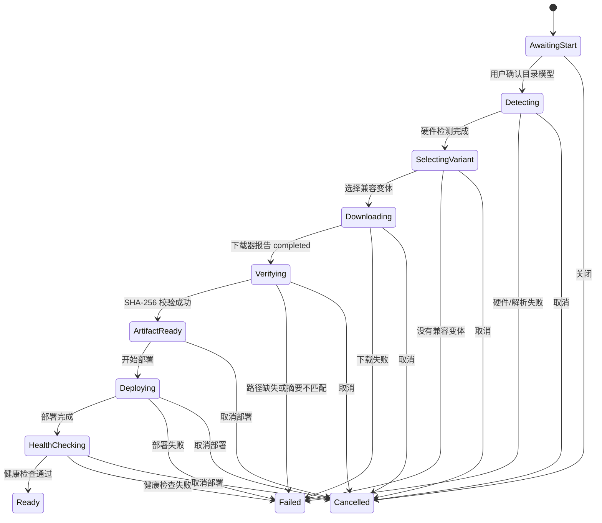
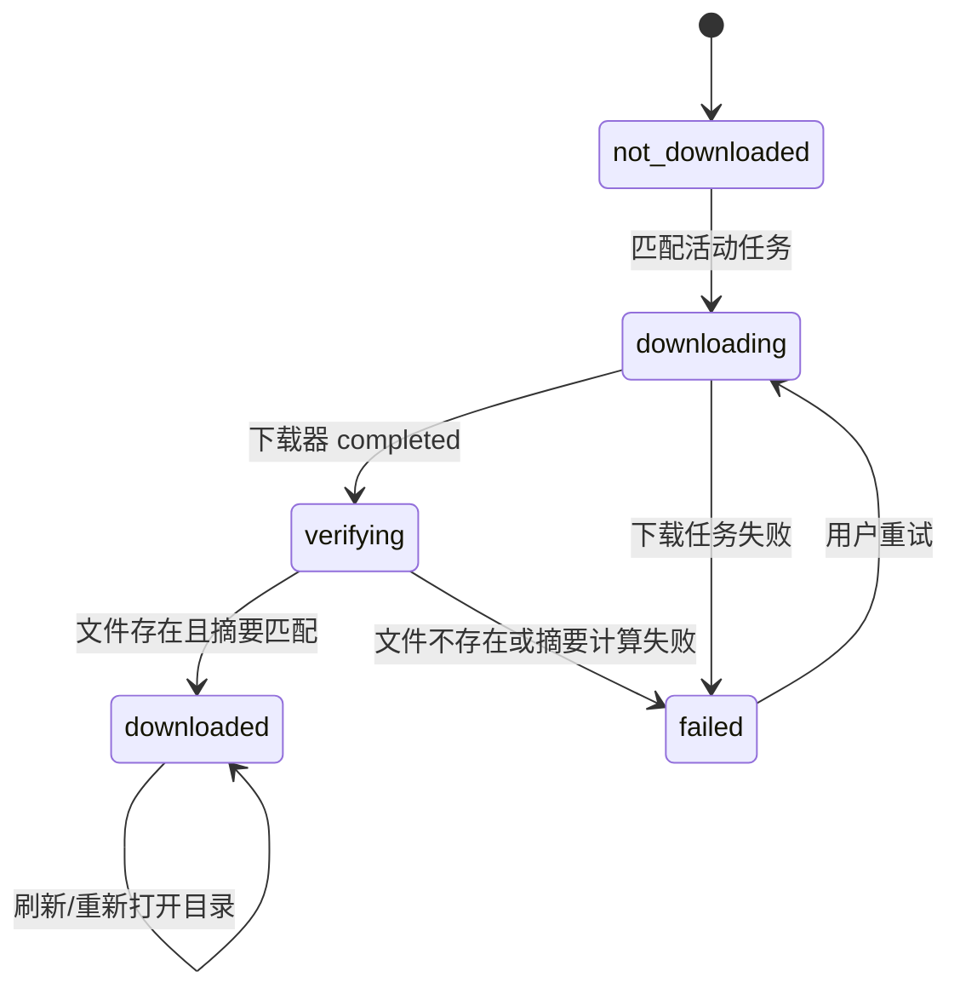
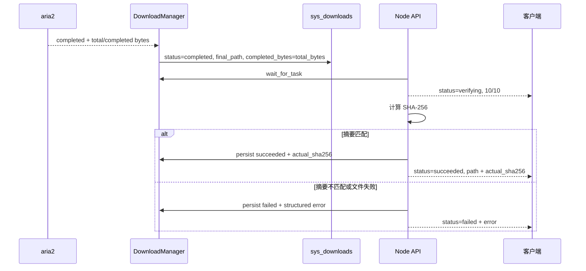

# model-download-reliability 状态流转流程图

## 设计边界

本次修复沿用现有 `PreparationStage`，不新增第二套初始化状态机。模型目录的本地工件状态只作为目录展示和防重复下载的补充状态，不能替代初始化阶段。

## 初始化状态流转



### 事件约束

1. `DownloadTaskCreated` 只允许在 `Downloading` 接收，并且必须产生有效十进制任务 ID。
2. `DownloadProgress` 只允许在 `Downloading` 接收；`completed_bytes` 不得倒退，`total_bytes` 为 `None` 表示未知，不用 `0` 表示未知。
3. `Downloaded` 只负责把阶段推进到 `Verifying`，不再根据一次落后的进度快照判断非法；最终完成必须由 `Verified` 携带路径和 SHA-256 确认。
4. `Verified` 只有在实际摘要与期望摘要一致、路径非空且当前 `run_id` 仍有效时才进入 `ArtifactReady`。
5. 所有异步回调都携带当前 `run_id`，过期回调不得改变状态。

## 模型目录本地工件状态



`downloaded` 必须同时满足：

```text
文件存在
+ sys_downloads.status == succeeded
+ actual_sha256 非空
+ actual_sha256 == checksum
+ model/source/revision/variant_id/artifact_uri/checksum 完整匹配
```

### 模型目录响应聚合

1. 服务端先按远程模型参数探测资源并保留原有顶层 `status` 语义。
2. 对每个可用变体按完整身份查询 `sys_downloads`。
3. 活动记录映射为 `downloading`，下载器完成但摘要尚未持久化为 `verifying`，匹配且校验成功为 `downloaded`，失败或校验不匹配为 `failed`。
4. 至少一个变体为 `downloaded` 时，模型级 `downloaded=true`；否则为 `false`。
5. 客户端显示本地工件状态优先于远程 `status` 的下载图标，已下载模型显示“已下载”和“使用”入口，禁止重复创建任务。

## 下载器完成与持久化顺序



## 并发约束

- 创建任务、查询复用记录和写入完整身份必须在同一下载启动互斥范围内完成。
- 旧 `run_id`、取消任务或已失败任务的回调不能修改新运行。
- 进度写入采用 `max(previous, incoming)`，最终态归一化为 `completed_bytes == total_bytes`。
- 清理旧 aria2 GID 或旧监控状态时必须按稳定 `task_id + gid` 匹配，不能删除新 GID 的状态。
