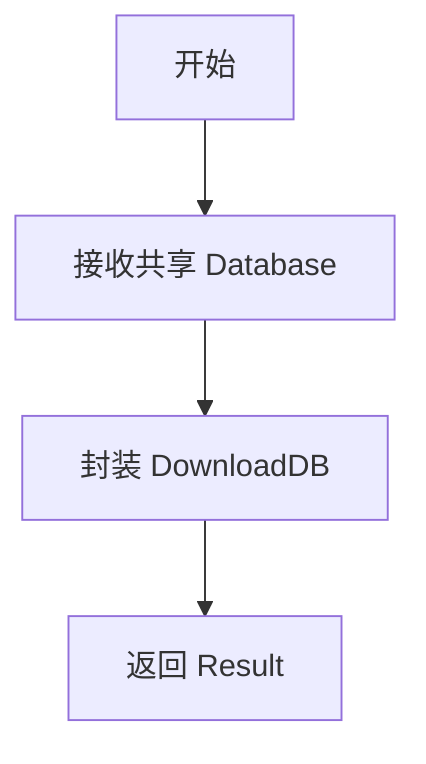
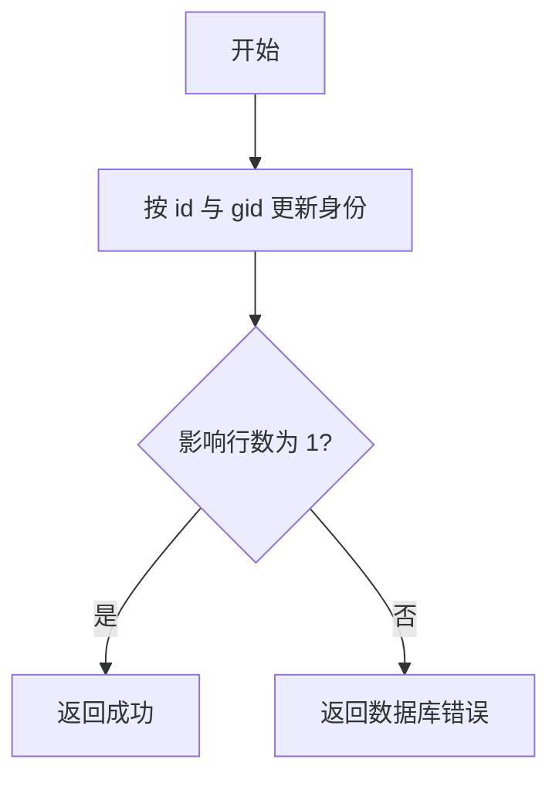
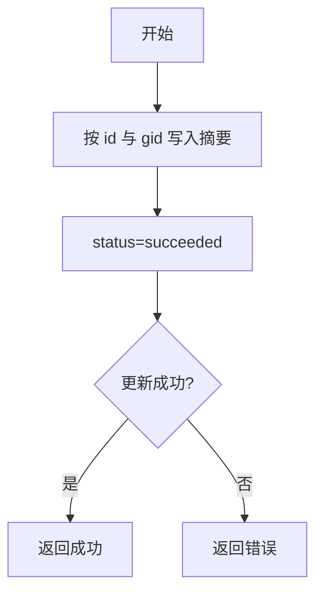
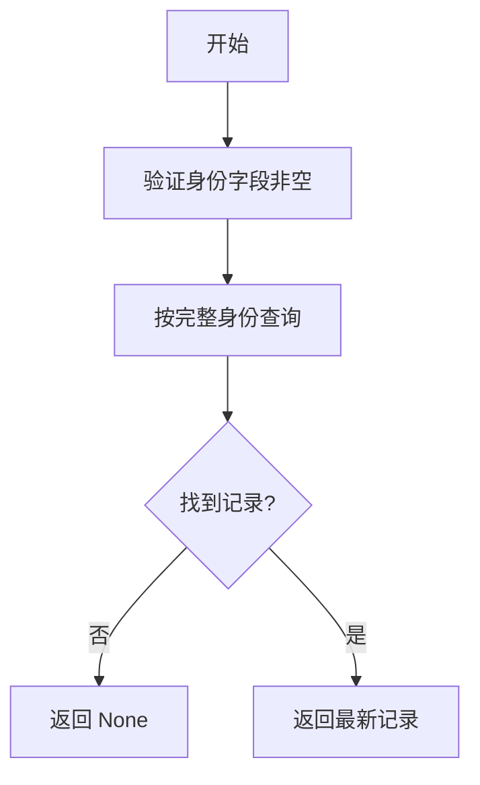

{
  "编号": "001",
  "依赖": []
}
# 001 扩展下载记录模型身份与校验持久化

- 任务：新增 0020 数据库迁移，扩展 `SysDownload` 字段与 `DownloadDB` 查询/状态更新接口。
- 工作区：database-sys（读写）——`crates/platform/storage/database-sys/`；database（读写）——`crates/platform/storage/database/`
- 产出：`model/source/revision/variant_id/artifact_uri/checksum/actual_sha256` 字段、兼容迁移、完整身份查询和校验终态写入接口。
- 验收标准：
  - 新数据库和已有 0019 数据库均能启动并完成迁移。
  - 旧记录身份字段为空但可正常读取，不能被完整身份查询命中。
  - `mark_verified` 原子写入 `succeeded`、`actual_sha256` 和完成时间。
  - `find_model_artifact` 只有完整身份字段全匹配才返回记录。
  - 数据库 API 测试覆盖迁移兼容、身份不匹配和成功/失败状态。

## 实现内容

### 数据结构

---

名称：`sys_downloads`
类型：数据库表
说明：持久化异步下载任务和已校验模型工件身份。
结构：

| 字段 | 类型 | 说明 |
| --- | --- | --- |
| `model` | `TEXT NULL` | 模型仓库身份 |
| `source` | `TEXT NULL` | 模型来源 |
| `revision` | `TEXT NULL` | 仓库修订号 |
| `variant_id` | `TEXT NULL` | 变体 ID |
| `artifact_uri` | `TEXT NULL` | 实际工件 URI |
| `checksum` | `TEXT NULL` | 请求期望 SHA-256 |
| `actual_sha256` | `TEXT NULL` | 本地文件实际 SHA-256 |

---

名称：`SysDownload`
类型：结构体
说明：数据库下载记录的 Rust 映射，新增字段保持可空以兼容旧记录。
结构：

```python
class SysDownload:
    model: Option<String>
    source: Option<String>
    revision: Option<String>
    variant_id: Option<String>
    artifact_uri: Option<String>
    checksum: Option<String>
    actual_sha256: Option<String>
```

### 函数定义

---

函数名称：`DownloadDB::new_shared_db`
公开属性：公有接口
多线程属性：异步
函数归属：`DownloadDB` 的方法
所属模块或包：`burncloud_database_sys::download`
职责说明：使用主服务已初始化的 `Arc<Database>` 创建下载数据库门面。
入参列表：

| 名称 | 类型 | 是否必填 | 含义 |
| --- | --- | --- | --- |
| `db` | `Arc<Database>` | 是 | 共享数据库连接 |

返回值列表：

| 名称 | 类型 | 含义 |
| --- | --- | --- |
| `Result<Self>` | 异步结果 | 下载数据库门面 |

错误返回：

| 错误类型 | 错误码 | 错误场景 |
| --- | --- | --- |
| `DatabaseError` | 数据库错误 | 数据库连接不可用 |

校验规则：黑盒校验
调用关系：

| 方向 | 函数 |
| --- | --- |
| 调用（内部函数） | `Database` 共享句柄封装 |
| 被调用（调用方） | `model_selection::routes` |

函数内部流程图：



---

函数名称：`DownloadDB::set_identity`
公开属性：公有接口
多线程属性：异步
函数归属：`DownloadDB` 的方法
所属模块或包：`burncloud_database_sys::download`
职责说明：为稳定任务写入完整模型工件身份，只更新当前 `id + gid` 记录。
入参列表：

| 名称 | 类型 | 是否必填 | 含义 |
| --- | --- | --- | --- |
| `id` | `i64` | 是 | 稳定任务 ID |
| `gid` | `&str` | 是 | 当前 aria2 GID |
| `model/source/revision/variant_id/artifact_uri/checksum` | `&str` | 是 | 完整身份字段 |

返回值列表：

| 名称 | 类型 | 含义 |
| --- | --- | --- |
| `Result<()>` | 异步结果 | 更新结果 |

错误返回：

| 错误类型 | 错误码 | 错误场景 |
| --- | --- | --- |
| `DatabaseError` | 更新失败 | 任务不存在或数据库写入失败 |

校验规则：白盒断言
调用关系：

| 方向 | 函数 |
| --- | --- |
| 调用（内部函数） | `execute_query_with_params` |
| 被调用（调用方） | `DownloadManager::set_task_identity` |

函数内部流程图：



---

函数名称：`DownloadDB::mark_verified`
公开属性：公有接口
多线程属性：异步
函数归属：`DownloadDB` 的方法
所属模块或包：`burncloud_database_sys::download`
职责说明：在摘要匹配后把任务原子切换为 `succeeded` 并保存实际摘要。
入参列表：

| 名称 | 类型 | 是否必填 | 含义 |
| --- | --- | --- | --- |
| `id` | `i64` | 是 | 稳定任务 ID |
| `gid` | `&str` | 是 | 当前 aria2 GID |
| `actual_sha256` | `&str` | 是 | 已计算实际摘要 |

返回值列表：

| 名称 | 类型 | 含义 |
| --- | --- | --- |
| `Result<()>` | 异步结果 | 成功终态写入结果 |

错误返回：

| 错误类型 | 错误码 | 错误场景 |
| --- | --- | --- |
| `DatabaseError` | 更新失败 | 旧任务回调或数据库错误 |

校验规则：白盒断言
调用关系：

| 方向 | 函数 |
| --- | --- |
| 调用（内部函数） | `execute_query_with_params` |
| 被调用（调用方） | `DownloadManager::mark_task_verified` |

函数内部流程图：



---

函数名称：`DownloadDB::find_model_artifact`
公开属性：公有接口
多线程属性：异步
函数归属：`DownloadDB` 的方法
所属模块或包：`burncloud_database_sys::download`
职责说明：按六项完整身份查找最新下载记录。
入参列表：

| 名称 | 类型 | 是否必填 | 含义 |
| --- | --- | --- | --- |
| `model/source/revision/variant_id/artifact_uri/checksum` | `&str` | 是 | 完整身份 |

返回值列表：

| 名称 | 类型 | 含义 |
| --- | --- | --- |
| `Result<Option<SysDownload>>` | 异步结果 | 匹配记录或无记录 |

错误返回：

| 错误类型 | 错误码 | 错误场景 |
| --- | --- | --- |
| `DatabaseError` | 查询失败 | 数据库读取失败 |

校验规则：黑盒校验
调用关系：

| 方向 | 函数 |
| --- | --- |
| 调用（内部函数） | `fetch_optional_with_params` |
| 被调用（调用方） | `model_selection::status` |

函数内部流程图：


