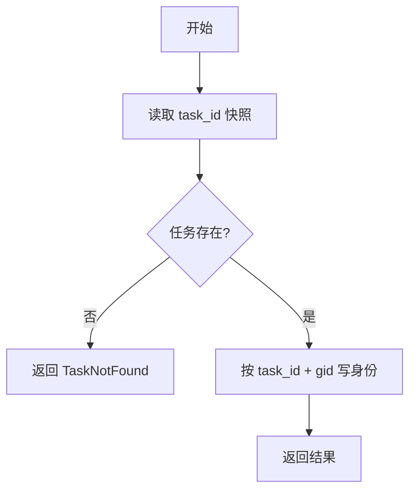
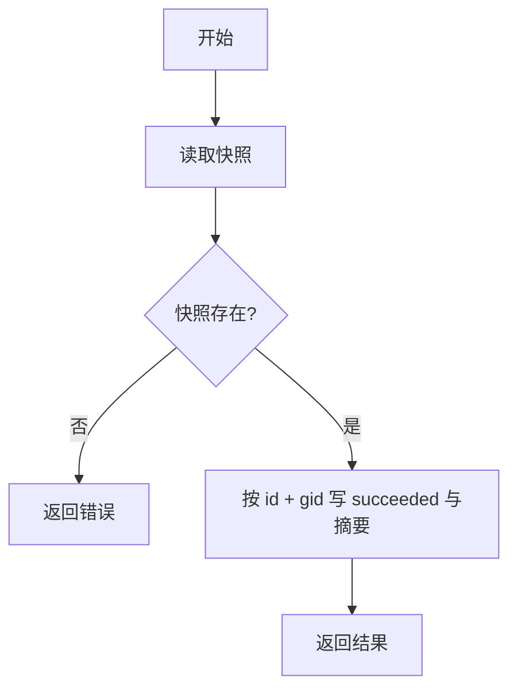
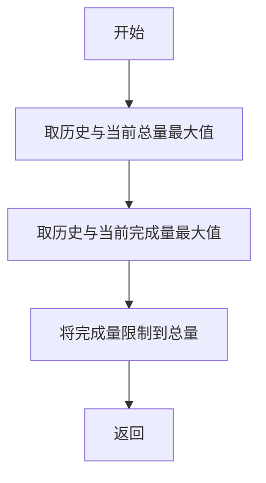

{
  "编号": "002",
  "依赖": ["001"]
}
# 002 修复下载器进度与终态归一化

- 任务：优化监控轮询、保证进度单调递增，并提供下载任务身份与校验终态写入方法。
- 工作区：download（读写）——`crates/platform/storage/download/`
- 产出：250ms 监控周期、单调进度、`completed_bytes == total_bytes` 终态、DownloadManager 持久化桥接方法及测试。
- 验收标准：
  - 连续快照 `0 → 5 → 10` 不倒退。
  - 完成快照总字节数和已完成字节数相等。
  - 未知总大小仍返回 `None`。
  - 旧任务 GID 不会更新新任务记录。
  - 新增公共方法有中文 rustdoc 和测试。

## 实现内容

### 函数定义

---

函数名称：`DownloadManager::set_task_identity`
公开属性：公有接口
多线程属性：异步并发
函数归属：`DownloadManager` 的方法
所属模块或包：`burncloud_download::operations`
职责说明：读取稳定任务快照并将完整模型身份委托给数据库。
入参列表：

| 名称 | 类型 | 是否必填 | 含义 |
| --- | --- | --- | --- |
| `task_id` | `i64` | 是 | 稳定任务 ID |
| `model/source/revision/variant_id/artifact_uri/checksum` | `&str` | 是 | 完整下载身份 |

返回值列表：

| 名称 | 类型 | 含义 |
| --- | --- | --- |
| `Result<()>` | 异步结果 | 身份写入结果 |

错误返回：

| 错误类型 | 错误码 | 错误场景 |
| --- | --- | --- |
| `DownloadError` | `TaskNotFound` / `Database` | 任务不存在或写入失败 |

校验规则：黑盒校验
调用关系：

| 方向 | 函数 |
| --- | --- |
| 调用（内部函数） | `get_task`、`DownloadDB::set_identity` |
| 被调用（调用方） | `create_download_task` |

函数内部流程图：

---

函数名称：`DownloadManager::mark_task_verified`
公开属性：公有接口
多线程属性：异步并发
函数归属：`DownloadManager` 的方法
所属模块或包：`burncloud_download::operations`
职责说明：把已通过摘要校验的任务持久化为 `succeeded`。
入参列表：

| 名称 | 类型 | 是否必填 | 含义 |
| --- | --- | --- | --- |
| `task_id` | `i64` | 是 | 稳定任务 ID |
| `actual_sha256` | `&str` | 是 | 实际摘要 |

返回值列表：

| 名称 | 类型 | 含义 |
| --- | --- | --- |
| `Result<()>` | 异步结果 | 持久化结果 |

错误返回：

| 错误类型 | 错误码 | 错误场景 |
| --- | --- | --- |
| `DownloadError` | `TaskNotFound` / `Database` | 任务不存在或写入失败 |

校验规则：白盒断言
调用关系：

| 方向 | 函数 |
| --- | --- |
| 调用（内部函数） | `get_task`、`DownloadDB::mark_verified` |
| 被调用（调用方） | `verify_task` |

函数内部流程图：

---

函数名称：`normalize_progress`
公开属性：私有函数
多线程属性：普通
函数归属：独立函数
所属模块或包：`burncloud_download::monitor`
职责说明：合并 aria2 当前进度与上次快照，保证总量和已完成字节单调合法。
入参列表：

| 名称 | 类型 | 是否必填 | 含义 |
| --- | --- | --- | --- |
| `previous_total` | `i64` | 是 | 上次总量 |
| `previous_completed` | `i64` | 是 | 上次已完成量 |
| `incoming_total` | `i64` | 是 | aria2 总量 |
| `incoming_completed` | `i64` | 是 | aria2 已完成量 |

返回值列表：

| 名称 | 类型 | 含义 |
| --- | --- | --- |
| `(i64, i64)` | 普通返回 | 归一化总量和完成量 |

校验规则：白盒断言
调用关系：

| 方向 | 函数 |
| --- | --- |
| 调用（内部函数） | 无 |
| 被调用（调用方） | `update_progress`、完成终态逻辑 |

函数内部流程图：

