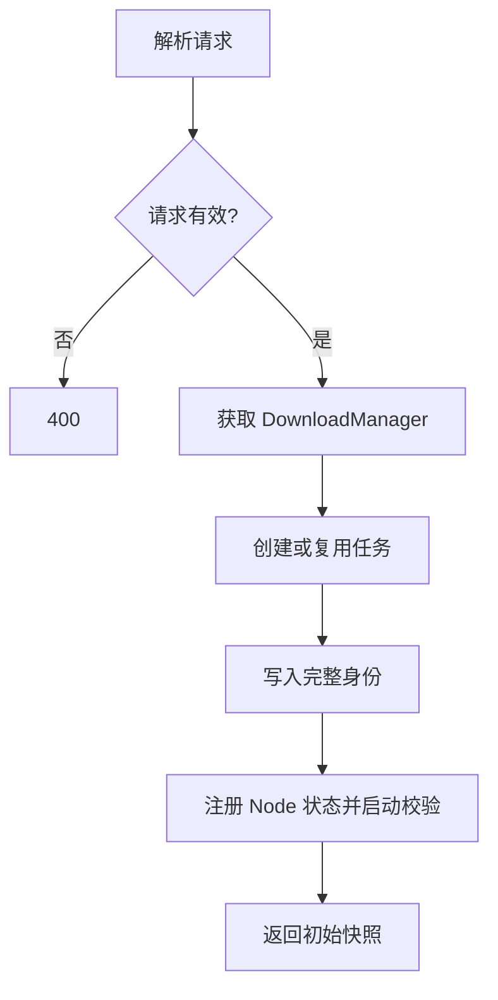
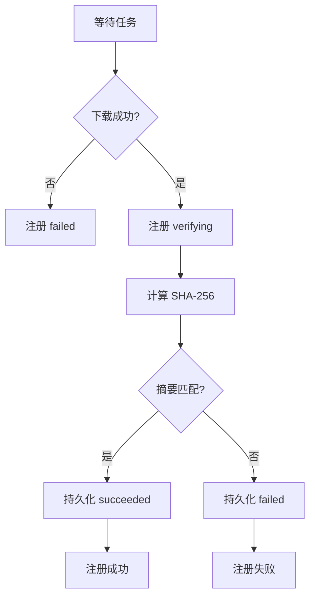

{
  "编号": "003",
  "依赖": ["002"]
}
# 003 修复 Node 下载任务完成持久化与回调一致性

- 任务：在模型下载 API 中写入完整身份、校验终态和失败终态，确保成功响应字段完整。
- 工作区：server-api（读写）——`crates/interfaces/server/src/api/`
- 产出：创建任务身份持久化、verify_task 成功/失败数据库更新、旧回调保护和响应契约测试。
- 验收标准：
  - `succeeded` 始终同时返回 `local_path` 和 `actual_sha256`。
  - 校验阶段返回 `verifying`，不提前返回 `succeeded`。
  - 摘要不匹配写入失败，下一次目录查询不显示已下载。
  - 取消、失败和旧任务回调不能覆盖成功或新任务状态。

## 实现内容

### 函数定义

---

函数名称：`create_download_task`
公开属性：私有函数（HTTP 路由处理器）
多线程属性：异步并发
函数归属：独立函数
所属模块或包：`burncloud_server::api::model_download`
职责说明：校验请求、创建/复用任务、持久化完整身份后返回初始快照。
入参列表：

| 名称 | 类型 | 是否必填 | 含义 |
| --- | --- | --- | --- |
| `State(state)` | `AppState` | 是 | 主服务共享状态 |
| `payload` | `Result<Json<DownloadModelRequest>, JsonRejection>` | 是 | 外部请求体 |

返回值列表：

| 名称 | 类型 | 含义 |
| --- | --- | --- |
| `Response` | HTTP 响应 | 初始任务或结构化错误 |

错误返回：

| 错误类型 | 错误码 | 错误场景 |
| --- | --- | --- |
| HTTP 400 | `invalid_download_request` | 请求身份无效 |
| HTTP 503 | `download_service_unavailable` | 下载器不可用 |
| HTTP 502 | `download_failed` | 下载任务创建失败 |

校验规则：黑盒校验
调用关系：

| 方向 | 函数 |
| --- | --- |
| 调用（内部函数） | `validate_request`、`DownloadManager::start_download`、`set_task_identity`、`register_task`、`spawn_task_verification` |
| 被调用（调用方） | Axum POST 路由 |

函数内部流程图：

---

函数名称：`verify_task`
公开属性：私有函数
多线程属性：异步并发
函数归属：独立函数
所属模块或包：`burncloud_server::api::model_download`
职责说明：等待下载、计算 SHA-256 并以原子顺序提交成功或失败终态。
入参列表：

| 名称 | 类型 | 是否必填 | 含义 |
| --- | --- | --- | --- |
| `manager` | `&DownloadManager` | 是 | 下载管理器 |
| `registry` | `&TaskRegistry` | 是 | Node 任务注册表 |
| `task_id` | `i64` | 是 | 稳定任务 ID |
| `identity` | `&DownloadRequestIdentity` | 是 | 完整身份 |

返回值列表：

| 名称 | 类型 | 含义 |
| --- | --- | --- |
| `()` | 普通返回 | 结果写入注册表和数据库 |

错误返回：

| 错误类型 | 错误码 | 错误场景 |
| --- | --- | --- |
| 任务错误 | `download_failed` | 下载等待失败 |
| 校验错误 | `checksum_mismatch` | 实际摘要不匹配 |
| 存储错误 | `download_storage_failed` | 文件读取或数据库更新失败 |

校验规则：白盒断言
调用关系：

| 方向 | 函数 |
| --- | --- |
| 调用（内部函数） | `wait_for_task`、`begin_verification`、`sha256_file`、`mark_task_verified`、`mark_task_verification_failed` |
| 被调用（调用方） | `spawn_task_verification` |

函数内部流程图：

