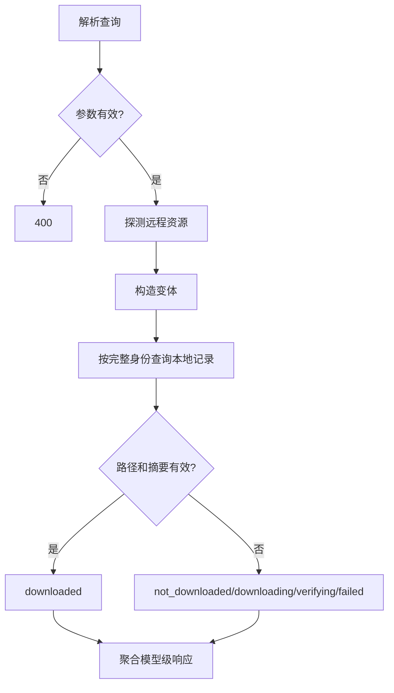

{
  "编号": "004",
  "依赖": ["001"]
}
# 004 扩展模型目录本地工件状态

- 任务：让 `/api/models/status` 查询 `sys_downloads` 并返回模型级、变体级本地工件状态。
- 工作区：server-model-selection（读写）——`crates/interfaces/server/src/model_selection/`
- 产出：兼容扩展的状态 JSON、完整身份匹配、路径校验和 API 回归测试。
- 验收标准：
  - 匹配的校验成功记录返回 `artifact_status=downloaded`、`downloaded=true`、路径和实际摘要。
  - 远程可下载但本地无记录返回 `not_downloaded`。
  - 活动/校验/失败记录映射正确。
  - 身份任一字段不匹配不能返回已下载。

## 实现内容

### 数据结构

---

名称：`StatusVariant`
类型：结构体
说明：远程变体和本地工件状态的兼容响应。
结构：

```python
class StatusVariant:
    id: str
    artifact_status: str
    downloaded: bool
    local_path: Optional[str]
    actual_sha256: Optional[str]
```

### 函数定义

---

函数名称：`status`
公开属性：私有函数（HTTP 路由处理器）
多线程属性：异步并发
函数归属：独立函数
所属模块或包：`burncloud_server::model_selection`
职责说明：保留远程资源探测语义，并聚合完整身份对应的本地工件状态。
入参列表：

| 名称 | 类型 | 是否必填 | 含义 |
| --- | --- | --- | --- |
| `State(state)` | `Arc<AppState>` | 是 | 模型目录共享状态 |
| `Query(query)` | `StatusQuery` | 是 | 预置或自定义模型参数 |

返回值列表：

| 名称 | 类型 | 含义 |
| --- | --- | --- |
| `Response` | HTTP 响应 | 兼容状态 JSON 或 400 |

错误返回：

| 错误类型 | 错误码 | 错误场景 |
| --- | --- | --- |
| HTTP 400 | `message` | 查询参数、预置 ID 或资源 URL 无效 |
| 数据库错误 | 内部记录并降级 | 不得伪装成 downloaded |

校验规则：黑盒校验
调用关系：

| 方向 | 函数 |
| --- | --- |
| 调用（内部函数） | `sources::probe`、`variants_for_resource`、`find_model_artifact`、文件元数据检查 |
| 被调用（调用方） | `/api/models/status` GET 路由 |

函数内部流程图：


