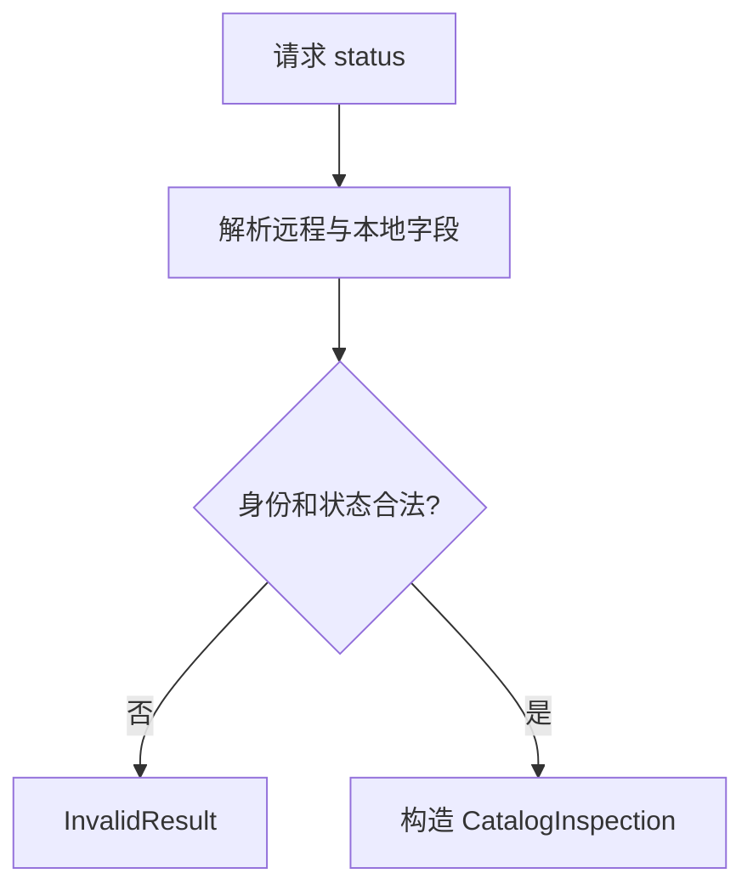
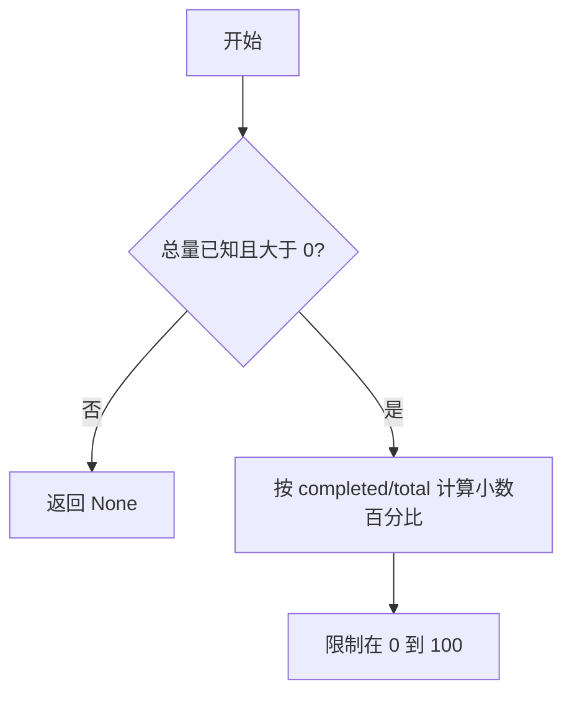

{
  "编号": "005",
  "依赖": ["003", "004"]
}
# 005 修复客户端目录状态、进度与阶段文案

- 任务：新增内部 `ArtifactStatus` / `CatalogInspection`，让选择器显示已下载状态，放宽 verifying 进度时序约束并优化页面文案与百分比。
- 工作区：client-chat（读写）——`crates/interfaces/client/src/domains/chat/`
- 产出：兼容解析、目录状态 UI、非重复下载入口、阶段文案和客户端回归测试。
- 验收标准：
  - `downloaded=true` 且路径/摘要有效时显示“已下载”和使用入口，不显示下载图标。
  - `downloading` / `verifying` 禁止重复确认。
  - verifying 阶段不因暂时落后的进度快照进入非法状态。
  - 进度不可倒退，早期非零字节能显示细粒度进度。
  - ArtifactReady/Deploying/HealthChecking/Ready 文案分别正确。

## 实现内容

### 数据结构

---

名称：`ArtifactStatus`
类型：枚举
说明：模型目录本地工件状态，不改变远程 `VersionStatus`。
结构：

```python
class ArtifactStatus(Enum):
    NotDownloaded = "not_downloaded"
    Downloading = "downloading"
    Verifying = "verifying"
    Downloaded = "downloaded"
    Failed = "failed"
```

---

名称：`CatalogInspection`
类型：结构体
说明：一次目录状态查询的远程资源、本地工件和校验凭据。
结构：

```python
class CatalogInspection:
    version: CatalogVersion
    remote_status: VersionStatus
    artifact_status: ArtifactStatus
    downloaded: bool
    local_path: Optional[str]
    actual_sha256: Optional[str]
```

### 函数定义

---

函数名称：`CatalogClient::inspect`
公开属性：公有接口（客户端域内）
多线程属性：异步
函数归属：`CatalogClient` 的方法
所属模块或包：`burncloud_client::domains::chat::catalog`
职责说明：解析兼容扩展的目录状态响应，并校验本地工件状态字段一致性。
入参列表：

| 名称 | 类型 | 是否必填 | 含义 |
| --- | --- | --- | --- |
| `model` | `&CatalogModel` | 是 | 当前目录行 |

返回值列表：

| 名称 | 类型 | 含义 |
| --- | --- | --- |
| `Result<CatalogInspection, ChatError>` | 异步结果 | 目录检查结果 |

错误返回：

| 错误类型 | 错误码 | 错误场景 |
| --- | --- | --- |
| `InvalidResult` | `status_response_invalid` | 字段缺失、不一致或摘要无效 |
| `NotConnected` | `transport` | 请求失败 |

校验规则：黑盒校验
调用关系：

| 方向 | 函数 |
| --- | --- |
| 调用（内部函数） | `CatalogModel::validate`、HTTP `get` |
| 被调用（调用方） | `load_status` |

函数内部流程图：



---

函数名称：`Preparation::progress_ratio`
公开属性：私有函数
多线程属性：普通
函数归属：`Preparation` 的方法
所属模块或包：`burncloud_client::domains::chat::model`
职责说明：返回可用于 HTML progress 的小数百分比，避免大文件早期整数长期为 0。
入参列表：无。
返回值列表：

| 名称 | 类型 | 含义 |
| --- | --- | --- |
| `Option<f64>` | 普通返回 | 0 到 100 的百分比 |

错误返回：无。
校验规则：白盒断言
调用关系：

| 方向 | 函数 |
| --- | --- |
| 调用（内部函数） | 无 |
| 被调用（调用方） | `page` |

函数内部流程图：


