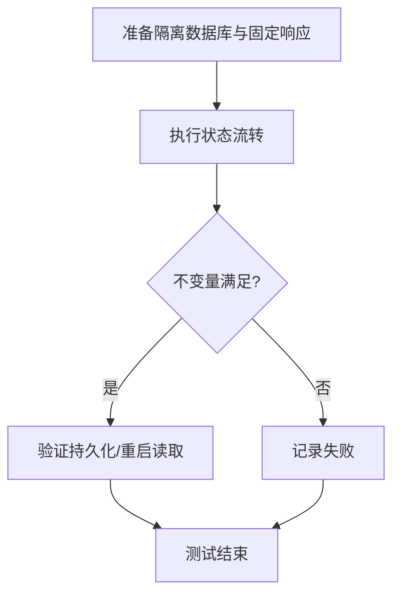

{
  "编号": "006",
  "依赖": ["005"]
}
# 006 增加模型下载可靠性回归与集成测试

- 任务：补齐数据库、下载器、服务端 API、客户端状态机和持久化重启场景的回归测试。
- 工作区：database-sys（读写）——`crates/platform/storage/database-sys/`；database（读写）——`crates/platform/storage/database/`；download（读写）——`crates/platform/storage/download/`；server-api（读写）——`crates/interfaces/server/src/api/`；server-model-selection（读写）——`crates/interfaces/server/src/model_selection/`；client-chat（读写）——`crates/interfaces/client/src/domains/chat/`
- 产出：独立测试文件或现有测试模块中的新增测试、固定 HTTP 回放和测试报告。
- 验收标准：
  - 覆盖 queued/downloading/verifying/succeeded/failed/cancelled。
  - 覆盖路径/摘要缺失、摘要不匹配、旧身份不匹配和旧 run_id。
  - 覆盖 `0 → 5 → 10` 单调进度和 `10/10` 终态。
  - 覆盖 API 返回 downloaded 和服务重启后的持久化读取。
  - `cargo fmt`、`cargo clippy`、目标 crate 测试通过。

## 实现内容

### 函数定义

---

函数名称：下载可靠性回归测试集合
公开属性：私有测试函数
多线程属性：异步并发与普通白盒测试
函数归属：各被测模块的独立测试模块
所属模块或包：数据库、下载器、服务端、客户端
职责说明：以固定输入验证本次需求的状态契约、持久化和进度不变量。
入参列表：无。
返回值列表：

| 名称 | 类型 | 含义 |
| --- | --- | --- |
| 测试断言 | `()` | 通过或失败 |

错误返回：测试失败由断言报告。
校验规则：黑盒校验 / 白盒断言
调用关系：

| 方向 | 函数 |
| --- | --- |
| 调用（内部函数） | 公开下载/数据库接口与客户端状态入口 |
| 被调用（调用方） | Cargo test |

函数内部流程图：

